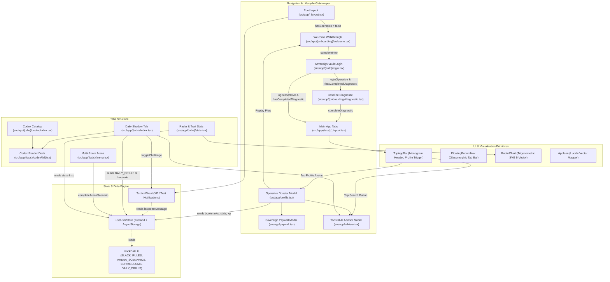

# Architecture Map: Black Rules Mobile Application

## System Overview
Production-grade strategic character development and social defense mobile subscription app built with Expo SDK 57 (React Native 0.86), Expo Router, NativeWind v4, Zustand with AsyncStorage persistence, and React Native SVG.

---

## Design System: Google Stitch Material-Luxury
- **Surfaces**:
  - `surface` / `surface-dim`: `#131315`
  - `surface-container-lowest`: `#0e0e10`
  - `surface-container-low`: `#1c1b1d`
  - `surface-container`: `#201f22`
  - `surface-container-high`: `#2a2a2c`
  - `surface-container-highest`: `#353437`
  - `surface-bright`: `#39393b`
- **Accents & Brand**:
  - `primary`: `#f2ca50` | `primary-container`: `#d4af37`
  - `secondary`: `#e8c35a` | `secondary-container`: `#896c00`
  - `on-surface`: `#e5e1e4` | `on-surface-variant`: `#d0c5af`
  - `outline`: `#99907c` | `outline-variant`: `#4d4635`
- **Typography Tokens**:
  - `display`: Playfair Display SemiBold
  - `body`: Inter (400 Regular / 500 Medium / 600 SemiBold)
  - `label` / `mono`: JetBrains Mono (500 Medium / 600 SemiBold)

---

## Component & State Dependency Graph (Graphify + Understand Anything)



---

## Screen & Component Inventory
```text
src/
├── app/
│   ├── _layout.tsx                     # Global Root Layout (Hydration gatekeeper, Global Toast, Stack registry)
│   ├── advisor.tsx                     # Sovereign AI Tactical Advisor Modal
│   ├── paywall.tsx                     # Sovereign Membership Elevation Modal
│   ├── profile.tsx                     # Operative Dossier Profile & Bookmarked Axioms Modal
│   ├── (auth)/
│   │   ├── _layout.tsx                 # Auth Stack
│   │   └── login.tsx                   # Screen 0: Sovereign Vault Passkey & Biometric Gateway
│   ├── (onboarding)/
│   │   ├── _layout.tsx                 # Onboarding Stack (welcome, diagnostic, paywall)
│   │   ├── welcome.tsx                 # 3-Slide Initiation Walkthrough
│   │   └── diagnostic.tsx              # 3-Step Baseline Calibration Diagnostic
│   └── (tabs)/
│       ├── _layout.tsx                 # Tab Layout with FloatingBottomNav
│       ├── index.tsx                   # Daily Shadow (Hero Rule, Daily Drill Rotation, Active Curriculums)
│       ├── codex/
│       │   ├── _layout.tsx             # Nested Codex Stack
│       │   ├── index.tsx               # Codex Archive Catalog (2-Column Bento Grid & Filters)
│       │   └── [id].tsx                # Swipeable Codex Reader (Deck Navigation & Segmented Tabs)
│       ├── arena.tsx                   # The Arena (Multi-Room Simulations: Room 04, 05, 06 [PRO])
│       └── stats.tsx                   # Character Stats (Trigonometric 5-Trait Defense Radar & Velocity)
├── components/
│   ├── ui/
│   │   ├── AppIcon.tsx                 # Lucide vector icon mapper
│   │   ├── TopAppBar.tsx               # Fixed luxury shell header with Monogram & Profile Avatar
│   │   ├── FloatingBottomNav.tsx       # Floating glassmorphic pill bottom navigation bar
│   │   ├── TacticalToast.tsx           # Global floating XP/Trait advancement pill banner
│   │   ├── Button.tsx                  # Tactile button primitive with Haptics
│   │   ├── Card.tsx                    # Elevated surface card primitive
│   │   └── Badge.tsx                   # Monospace telemetry badge
│   └── features/
│       └── RadarChart.tsx              # High-Fidelity Trigonometric 320x320 SVG Defense Radar
├── store/
│   ├── useUserStore.ts                 # Zustand store with AsyncStorage persistence & lifecycle state
│   └── mockData.ts                     # BLACK_RULES, CURRICULUMS, ARENA_SCENARIOS, DAILY_DRILLS
├── theme/
│   └── tokens.ts                       # Google Stitch Material-Luxury tokens
└── types/
    └── index.ts                        # Strict TypeScript schemas (TraitKey, BlackRule, ArenaScenario, etc.)
```
